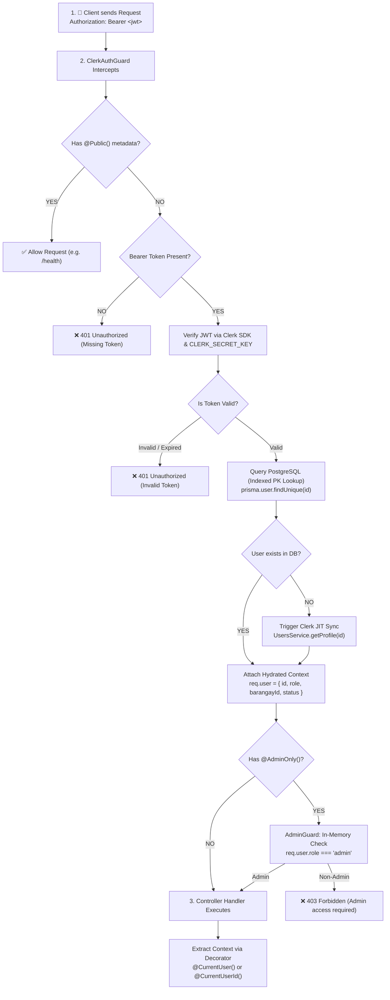

# Authentication & Security Lifecycle

Sagana Backend delegates user identity, authentication, session security, and credential management to **Clerk** via `@clerk/backend`, and hydrates an in-memory session context for every authenticated request.

---

## 🔒 Global Protection Model

By default, **every route in the backend is guarded and private**. 

The [`ClerkAuthGuard`](../../src/core/guards/clerk-auth.guard.ts) is registered as a global guard in [`AppModule`](../../src/app.module.ts):

Swagger at `/api/docs` labels each endpoint by access:

1. **Public**: `@Public()` bypasses the Clerk guard; no token is required.
2. **Shared**: a valid Clerk bearer token is required. Admins and operators can call these endpoints, subject to any profile or barangay restrictions described on the operation.
3. **Admin**: a valid token and `@AdminOnly()` are required. The guard checks the user's hydrated admin role in memory without additional database queries.

In Swagger, select **Authorize** and enter a Clerk token to call protected endpoints. Labels and lock icons document the guards; they do not enforce permissions.

```typescript
// app.module.ts
providers: [
  {
    provide: APP_GUARD,
    useClass: ClerkAuthGuard,
  },
]
```

---

## 🧭 Authentication & Request Hydration Lifecycle

When a client makes a request with a Clerk Bearer token, `ClerkAuthGuard` verifies the cryptographic signature and immediately hydrates the request with the user's database state (`role`, `barangayId`, `status`) at the authentication boundary.



---

## 📦 Request Context Payload (`RequestUser`)

The hydrated user session is typed via the `RequestUser` interface in [`src/core/types/auth.types.ts`](../../src/core/types/auth.types.ts) and attached directly to the Express `Request` object:

```typescript
export interface RequestUser {
  id: string;              // Clerk User ID (e.g. "user_2bX...")
  role: string;            // User role: "admin" | "operator"
  barangayId: string | null; // Assigned barangay CUID, or null if unassigned
  status: string;          // Account status: "active" | "suspended" | "unindexed"
}
```

### Payload Properties Breakdown

| Property | Type | Description | Example |
| :--- | :--- | :--- | :--- |
| **`id`** | `string` | The verified primary key from the Clerk JWT `sub` claim. | `"user_2t1aBc..."` |
| **`role`** | `string` | User access tier (`"admin"` or `"operator"`). Used by `AdminGuard`. | `"admin"` |
| **`barangayId`** | `string \| null` | Foreign key referencing the assigned `barangays` table record, or `null`. | `"cly10abcd0001..."` |
| **`status`** | `string` | Operational state of the user account. | `"active"` |

### ⚡ Request-Scoped Memory & Serverless / Cold Starts

The hydrated `req.user` payload is strictly **request-scoped**:
- It lives in Node.js memory only for the lifespan of that single HTTP request (~10ms).
- When the response is dispatched, the request object is garbage-collected.
- **Backend sleep/restart safe**: Even if the backend server was completely idle or asleep (e.g., Render/Railway dyno sleep), every incoming request performs its initial indexed lookup upon wake-up. No persistent cache synchronization across server instances is required.

---

## 🏷️ Custom Decorators

### 1. `@Public()`
Bypasses the global `ClerkAuthGuard`. Use this for health checks and unauthenticated public endpoints.

```typescript
import { Controller, Get } from '@nestjs/common';
import { Public } from 'src/core/decorators/public.decorator';

@Controller('health')
export class HealthController {
  @Public()
  @Get()
  checkHealth() {
    return { status: 'healthy' };
  }
}
```

---

### 2. `@CurrentUser()`
Injects the full hydrated `RequestUser` session object, or a specific field when provided with a property key.

```typescript
import { Controller, Get } from '@nestjs/common';
import { CurrentUser } from 'src/core/decorators/current-user.decorator';
import type { RequestUser } from 'src/core/types/auth.types';

@Controller('machines')
export class MachinesController {
  // Injects full hydrated user context
  @Get()
  listForUser(@CurrentUser() user: RequestUser) {
    return this.machinesService.findAllByBarangay(user.barangayId);
  }

  // Injects a single specific field directly
  @Get('my-barangay')
  getBarangay(@CurrentUser('barangayId') barangayId: string | null) {
    return { barangayId };
  }
}
```

---

### 3. `@CurrentUserId()`
Convenience decorator extracting only the authenticated user's Clerk ID (`string`). Fully backward-compatible with all existing controller methods.

```typescript
import { Controller, Get } from '@nestjs/common';
import { CurrentUserId } from 'src/core/decorators/current-user.decorator';

@Controller('me')
export class UsersController {
  @Get()
  getProfile(@CurrentUserId() userId: string) {
    return this.usersService.getProfile(userId);
  }
}
```

---

### 4. `@AdminOnly()`
Restricts endpoint access strictly to users with `role: 'admin'`. Evaluates synchronously in memory via [`AdminGuard`](../../src/core/guards/admin.guard.ts) in 0ms without hitting PostgreSQL.

```typescript
import { Controller, Get } from '@nestjs/common';
import { AdminOnly } from 'src/core/decorators/admin-only.decorator';

@AdminOnly()
@Controller('operators')
export class UsersAdminController {
  @Get()
  getOperators() {
    // Only accessible by authenticated barangay admins
  }
}
```
