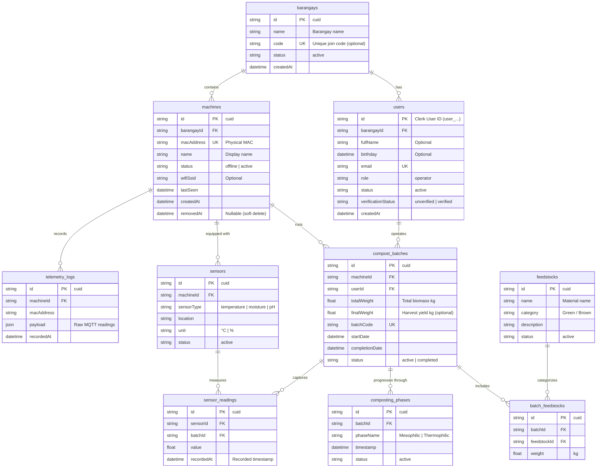

# PostgreSQL & Prisma 7 Schema

Sagana Backend uses **PostgreSQL** hosted on Neon, managed with **Prisma 7** and driver adapters for high connection efficiency.

---

## 🗄️ Connection Pooling with `@prisma/adapter-pg`

Rather than relying purely on Prisma's internal binary engine for connections, the backend utilizes `pg.Pool` coupled with `@prisma/adapter-pg` in [`PrismaService`](../../src/infrastructure/database/prisma.service.ts):

```typescript
@Injectable()
export class PrismaService extends PrismaClient implements OnModuleInit, OnModuleDestroy {
  constructor() {
    const pool = new Pool({ connectionString: process.env.DATABASE_URL });
    const adapter = new PrismaPg(pool);
    super({ adapter });
  }

  async onModuleInit() {
    await this.$connect();
  }

  async onModuleDestroy() {
    await this.$disconnect();
  }
}
```

---

## 📐 Database Models & Entity Relationship



---

## 🛠️ Prisma Management Commands

```bash
# Push schema changes directly to development database
pnpm prisma db push

# Generate Prisma Client and Zod types
pnpm prisma generate

# Open interactive Prisma Studio in browser
pnpm prisma studio

# Seed initial barangay join codes
pnpm run seed:barangay-codes

# Run machine hard-delete maintenance cleanup
pnpm run delete:machines
```
