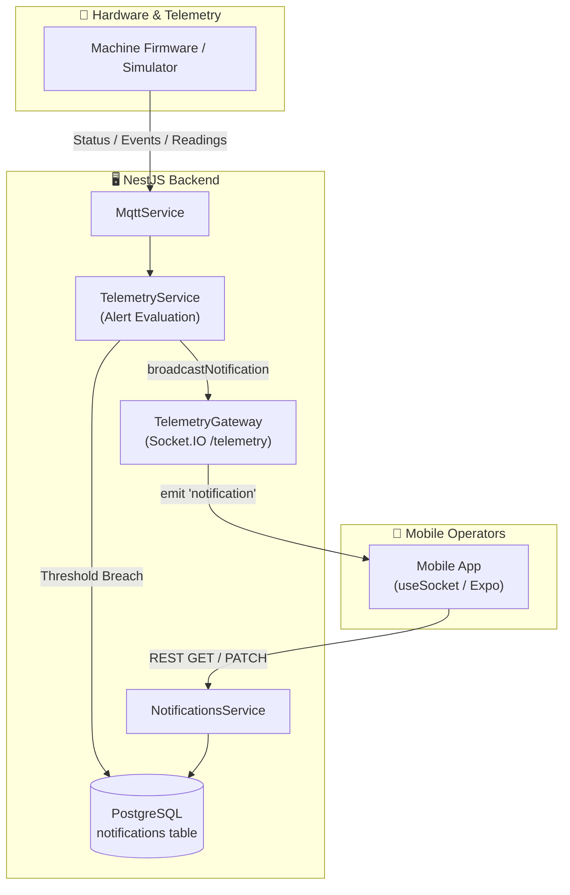

# In-App Notifications & Alert Dispatch

The **Notifications Module** provides database-backed in-app alerts, REST endpoints for operator interaction, and real-time Socket.IO dispatch to isolated barangay rooms.

---

## 🏗️ Architecture & Data Flow



---

## 🗄️ Database Model (`notifications`)

Stored in PostgreSQL via Prisma with composite indexes for fast paginated and unread querying:

| Field | Type | Attributes | Description |
| :--- | :--- | :--- | :--- |
| `id` | `String` | `@id @default(cuid())` | Unique notification identifier |
| `barangayId` | `String` | Foreign Key | Scopes alert strictly to operator's barangay |
| `machineId` | `String?` | Foreign Key, Nullable | Associated machine (if triggered by hardware) |
| `batchId` | `String?` | Foreign Key, Nullable | Associated active batch (if batch-specific) |
| `userId` | `String?` | Foreign Key, Nullable | Recipient/creator user |
| `type` | `String` | | Category: `machine`, `sensor`, `automation`, `system` |
| `severity` | `String` | `@default("info")` | Priority: `info`, `warning`, `critical` |
| `title` | `String` | | Alert headline (e.g. `Emergency Stop Triggered`) |
| `message` | `String` | | Detailed message text |
| `metadata` | `Json` | `@default("{}")` | Contextual payload (temperatures, MAC, routes) |
| `isRead` | `Boolean` | `@default(false)` | Read status flag |
| `readAt` | `DateTime?` | Nullable | Timestamp when operator marked as read |
| `createdAt` | `DateTime` | `@default(now())` | Creation timestamp |

### Indexes
- `@@index([barangayId, createdAt])` — Accelerates default chronological pagination.
- `@@index([barangayId, isRead])` — Accelerates unread count badges and `unreadOnly=true` filtering.

---

## 📍 REST API Endpoints

All routes are protected by `ClerkAuthGuard` and automatically scope queries to the authenticated operator's `barangayId`.

| Method | Endpoint | Description |
| :--- | :--- | :--- |
| **`GET`** | `/notifications` | Paginated notifications list (`?limit=50&offset=0&unreadOnly=true`). |
| **`GET`** | `/notifications/unread-count` | Returns `{ unreadCount: number }` for the operator's barangay. |
| **`POST`** | `/notifications` | Creates a manual alert and broadcasts it immediately to the barangay room. |
| **`PATCH`** | `/notifications/:id/read` | Marks a specific notification as read (`isRead: true`, `readAt: now`). |
| **`PATCH`** | `/notifications/read-all` | Bulk marks all unread notifications in the barangay as read. |

---

## ⚡ Automated MQTT Alert Triggers

The backend automatically creates database records and dispatches alerts over Socket.IO when specific telemetry conditions are met in `TelemetryService`:

1. **Machine Offline (`warning`)**:
   - Triggered when device status drops or MQTT Last Will and Testament (LWT) fires (`sagana/devices/:mac/status` with `status: offline`).
   - Title: `"{Machine Name} Offline"`.
2. **Emergency Stop / Alarms (`critical`)**:
   - Triggered by discrete safety events on `sagana/devices/:mac/events` with `type: emergency_stop`, `e_stop`, or `alarm`.
   - Title: `"Emergency Stop Triggered"`.
3. **Core Overheat Alert (`critical`)**:
   - Triggered when continuous telemetry on `sagana/devices/:mac/telemetry` reports `temperature > 75°C`.
   - Title: `"High Temperature Alert"`.

---

## 🔒 Security & Barangay Room Isolation

- **Room Partitioning**: Real-time events are emitted strictly to `barangay:${barangayId}` rooms.
- **Identity Gating**: When a client emits `join_barangay`, `TelemetryGateway` authorizes the join using only the verified identity stored on the socket (`client.data.barangayId`). Client-supplied body IDs cannot override or spoof room subscriptions.
- **Local Dev Auth Bypass**: For rapid local testing without Clerk token expiration, the server accepts `Bearer dev_operator` **only** if both flags are affirmatively enabled in `.env.local`:
  ```env
  NODE_ENV="development"
  ENABLE_DEV_AUTH_BYPASS="true"
  ```

---

## 📬 Bruno Collection
Requests are documented under [bruno/notifications/](file:///c:/Users/Denz/Desktop/likha/sagana-backend/bruno/notifications/):
- `List Notifications.bru`
- `Get Unread Count.bru`
- `Create Notification.bru`
- `Mark As Read.bru`
- `Mark All As Read.bru`
