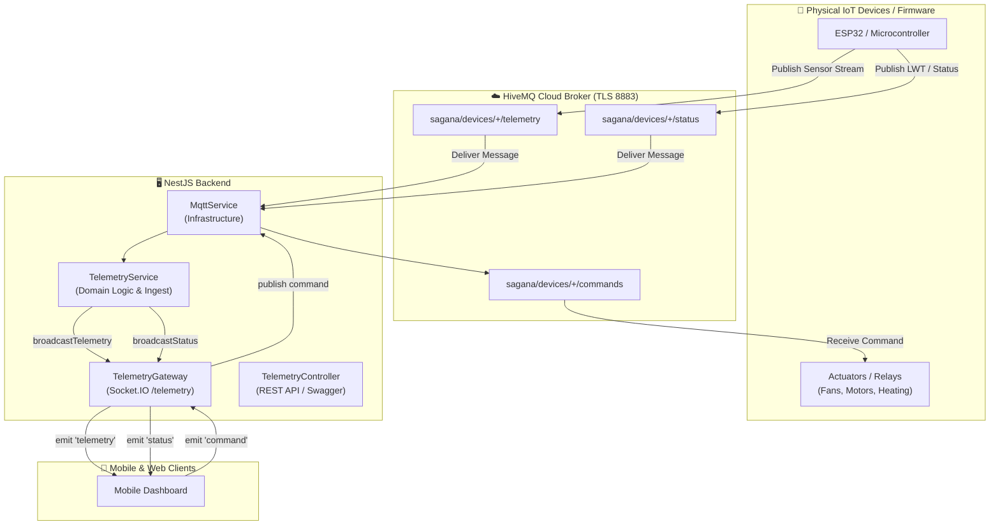

# Telemetry & MQTT Integration (HiveMQ)

The **Telemetry & MQTT Module** manages real-time IoT device communication, live telemetry streaming, device online/offline status detection, and downlink hardware commands through a managed **HiveMQ Cloud** MQTT broker.

---

## 🏗️ Architecture & Data Flow



---

## 📡 MQTT Topic Specification

| Topic Pattern | Direction | QoS | Purpose |
| :--- | :--- | :---: | :--- |
| **`sagana/devices/:macAddress/telemetry`** | Firmware → Broker → Backend | `1` | Live telemetry readings (temperature, humidity, moisture, pH, methane). Stored in `telemetry_logs` and broadcast to clients. |
| **`sagana/devices/:macAddress/status`** | Firmware → Broker → Backend | `1` | Device online / offline status (including MQTT Last Will and Testament `LWT`). Updates `machine.status` and `lastSeen`. |
| **`sagana/devices/:macAddress/commands`** | Backend → Broker → Firmware | `1` | Downlink control messages (e.g. `{"action": "SET_NAME", "name": "..."}`, relay controls). |

::: tip 🔄 Automatic Device Name Synchronization
When an ESP32 device publishes `"status": "online"`, the backend automatically checks if a friendly name exists in PostgreSQL and pushes `{"action": "SET_NAME", "name": machine.name}` to `sagana/devices/<macAddress>/commands` so the hardware stays in sync.
:::

---

## 🚦 Understanding Quality of Service (QoS)

| QoS Level | Guarantee | Delivery Mechanism | Lost Messages? | Duplicates? | Best For |
| :---: | :--- | :--- | :---: | :---: | :--- |
| **`0`** | **At most once** *(Fire & forget)* | Message sent once without acknowledgment. | ⚠️ Possible | ❌ Never | High-frequency, non-critical metrics. |
| **`1`** | **At least once** *(Default ⭐)* | Retries until `PUBACK` receipt is confirmed. | ❌ Never | ⚠️ Possible | **Compost telemetry & hardware commands**. |
| **`2`** | **Exactly once** *(Handshake)* | 4-step confirmation handshake. | ❌ Never | ❌ Never | Irreversible critical operations. |

---

## 📍 REST API Endpoints

| Method | Endpoint | Protected | Description |
| :--- | :--- | :---: | :--- |
| **`POST`** | `/telemetry/devices/:deviceId/command` | 🔒 Yes | Dispatches an MQTT command down to a physical hardware device. |

---

## ⚡ Socket.IO Real-Time Gateway (`/telemetry`)

The backend exposes a real-time **Socket.IO Gateway** mounted on namespace **`/telemetry`** (`cors: origin: '*'`).

### 1. Gateway Server → Client (Broadcast Events)

| Event Name | Payload Structure | Description |
| :--- | :--- | :--- |
| **`telemetry`** | `{ machineId, macAddress, name, barangayId, timestamp, ...readings }` | Enriched sensor readings from MQTT stream. |
| **`status`** | `{ machineId, macAddress, status }` | Device connectivity transition (`active` vs `offline`). |
| **`machine_added`** | `{ machineId, name, macAddress, barangayId, wifiSsid, status, createdAt }` | Broadcast when a new machine is registered or re-provisioned. |
| **`machine_updated`** | `{ machineId, name, barangayId }` | Broadcast when a machine is renamed or modified. |
| **`machine_removed`** | `{ machineId, barangayId }` | Broadcast when a machine is soft-deleted. |

### 2. Client → Server (Inbound Events)

| Event Name | Request Payload | Action |
| :--- | :--- | :--- |
| **`command`** | `string \| object` | Forwards actuator/control payload directly to the device's MQTT command topic. |

---

## 🧪 Testing with HiveMQ Cloud Web Client

1. Open **HiveMQ Cloud Console** → **Cluster** → **Web Client**.
2. Subscribe to:
   * `sagana/devices/+/commands` (to observe outgoing commands from backend/mobile)
   * `sagana/devices/+/status`
3. Publish test telemetry:
   * **Topic**: `sagana/devices/20:50:0D:E6:C0:3C/telemetry`
   * **Payload**:
     ```json
     { "temperature": 55.4, "humidity": 68.2, "moisture": 62.0 }
     ```
   * Click **Publish**. Connected mobile clients instantly receive the live event!
